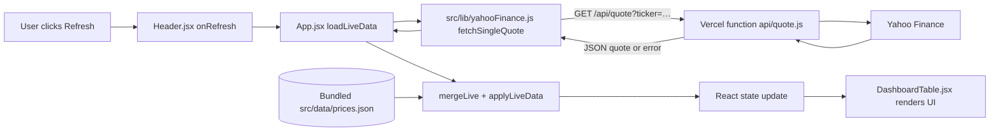

Here’s a nicely formatted version of the README content:

# SGXPTY

## What this is

SGXPTY is a client-rendered dashboard for Singapore-listed REITs, ETFs, and dividend stocks. It combines reference information maintained in the codebase with nightly-calculated market data and options for live market refreshes.

## Stack

- Frontend: React 18 with Vite
  - `src/main.jsx` mounts the app
  - `src/App.jsx` owns the dashboard’s main state and view logic
- UI and charts:
  - Tailwind CSS for styling
  - Recharts for chart rendering
  - Lucide React for icons
- Backend:
  - Vercel serverless functions in `api/`
  - Includes `api/quote.js` and `api/quotes-batch.js`
  - These fetch quotes from Yahoo Finance and return JSON
- Database:
  - None
  - Persistent data is stored as JSON in the repository, such as:
    - `src/data/prices.json`
    - `public/rates.json`
    - `public/sora.json`
  - Nightly updates write and commit those files
- Authentication:
  - No visible authentication
  - The quote endpoints do not require a login or API token
- State management:
  - React component state and hooks in `src/App.jsx` and child components
  - No global state library or server-side user state
- External APIs:
  - Yahoo Finance for quotes, dividends, and fundamentals
  - FRED for US interest rates
  - open.er-api.com for currency rates
  - PropKaki for SORA data
  - Scheduled fetchers are in `scripts/`
- Infrastructure and hosting:
  - Vercel configuration is in `vercel.json`
  - Scheduled data refresh and commits are handled by GitHub Actions in:
    - `.github/workflows/daily-sync.yml`
    - `.github/workflows/update-prices.yml`

## How it’s organized

```text
api/                  Vercel quote endpoints
data/                 Ticker mapping data
public/               Static rates and SORA JSON served to the browser
scripts/              Nightly data fetchers and calculation helpers
src/
  components/         Dashboard, tables, comparisons, charts, rates UI
  data/               Asset reference data and generated price data
  lib/                Quote merging and analytics helpers
  utils/              Ticker normalization
.github/workflows/    Scheduled data sync workflows
```

## How it fits together

### Live quote refresh flow

The user clicks Refresh. `src/components/Header.jsx` calls its `onRefresh` prop. In `src/App.jsx`, that prop is `loadLiveData`.

The app prepares the refresh:

- `loadLiveData` resets progress
- Creates an `AbortController`
- Builds a ticker list from REITs, ETFs, and stocks imported from `src/data/`

The browser requests quotes one at a time. For each ticker, `loadLiveData` calls `fetchSingleQuote` in `src/lib/yahooFinance.js`. That function requests:

`/api/quote?ticker=...`

On the server, the Vercel handler in `api/quote.js`:

- Adds `.SI` when needed
- Calls Yahoo Finance via `fetchWithRetry`
- Maps the result into a cleaned quote payload

The browser then merges the live values with the nightly data. Back in `loadLiveData`, the quote is saved in `liveMapRef`. `mergeLive` in `src/lib/yahooFinance.js` overlays selected market fields on `DAILY_PRICES` and related datasets.

React updates the display. The updated arrays are stored via `setReitsData`, `setEtfsData`, and `setStocksData`. `src/components/DashboardTable.jsx` filters, sorts, and renders the data, including either live or stale fallback values depending on refresh state.

There is no database involved in this flow: the live request goes to Yahoo Finance, while the fallback and nightly values come from the bundled JSON files.

### Nightly data flow

The scheduled workflow in `.github/workflows/daily-sync.yml` runs:

- `scripts/update-sora.mjs`
- `scripts/update-rates.mjs`
- tests
- `scripts/fetch-prices.mjs`

The price fetcher uses `scripts/lib/calc.mjs` to compute derived values and writes the generated data into the repo, including `src/data/prices.json` and related JSON files.

## Request lifecycle diagram



If you want, I can also turn this into:
- a more polished GitHub README with badges and install steps
- a shorter version for the repo landing page
- a version tailored to a more technical audience or a more investor-facing audience
